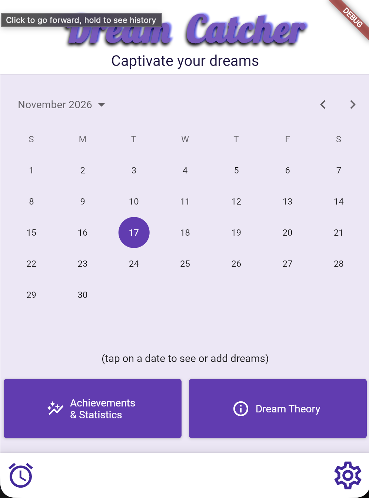
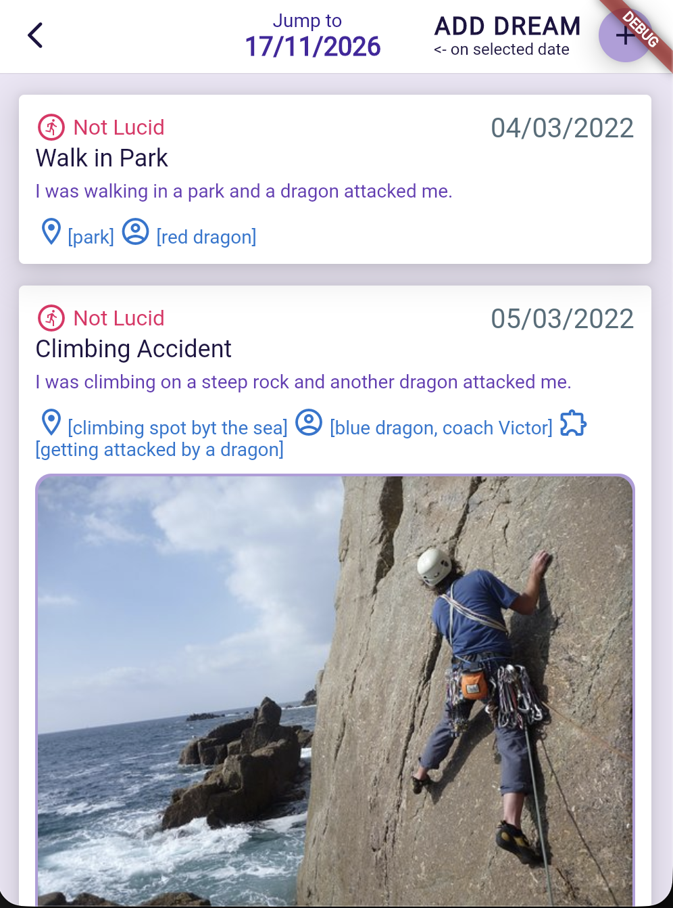
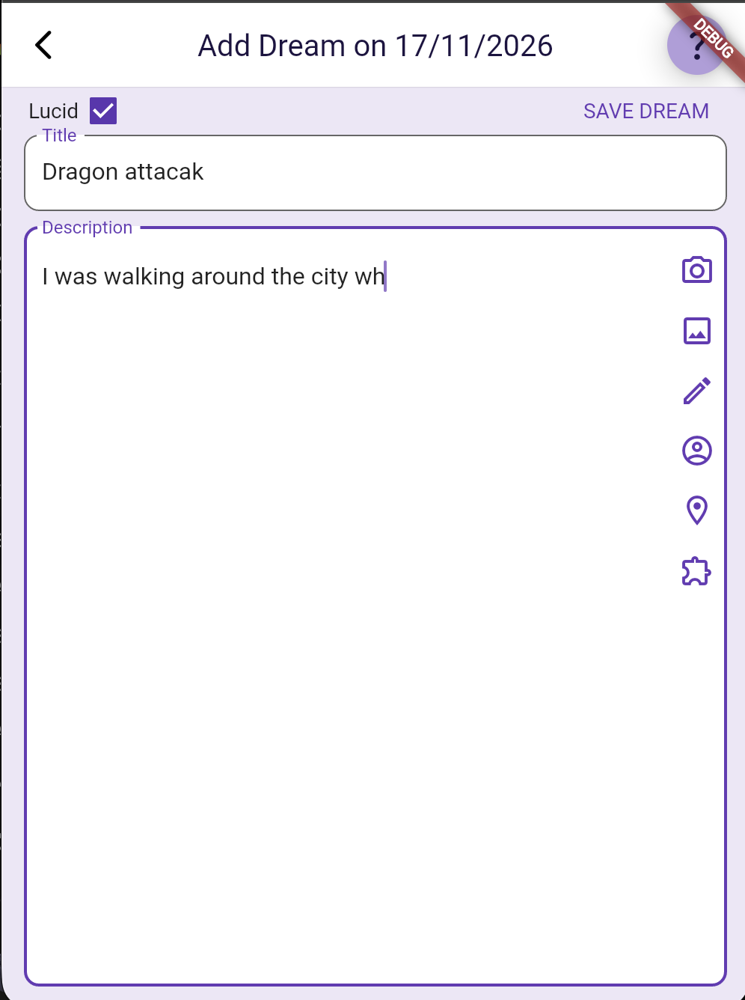
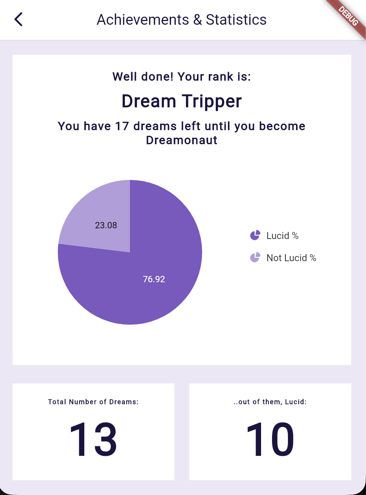
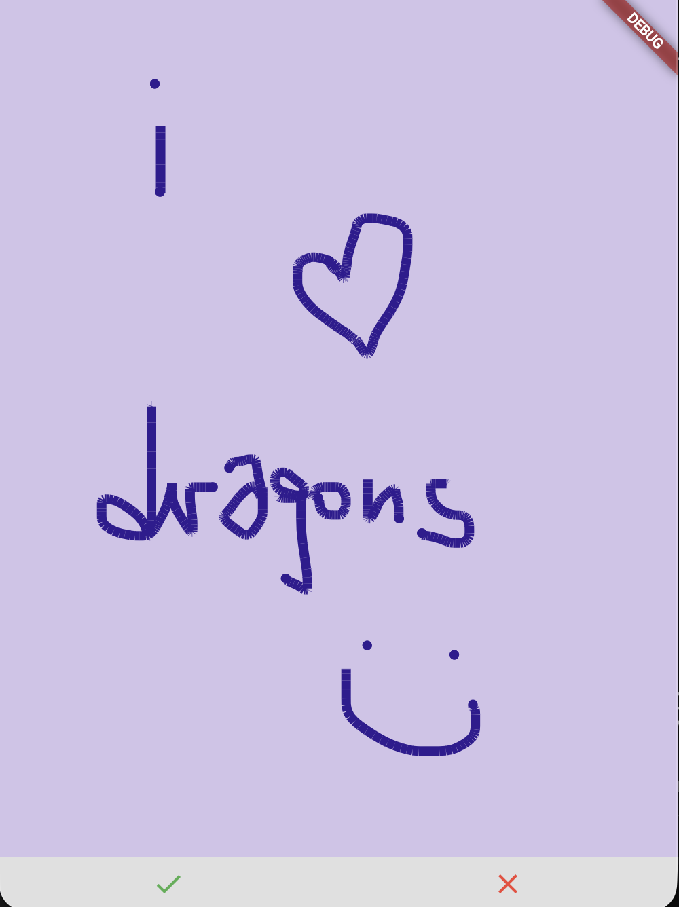
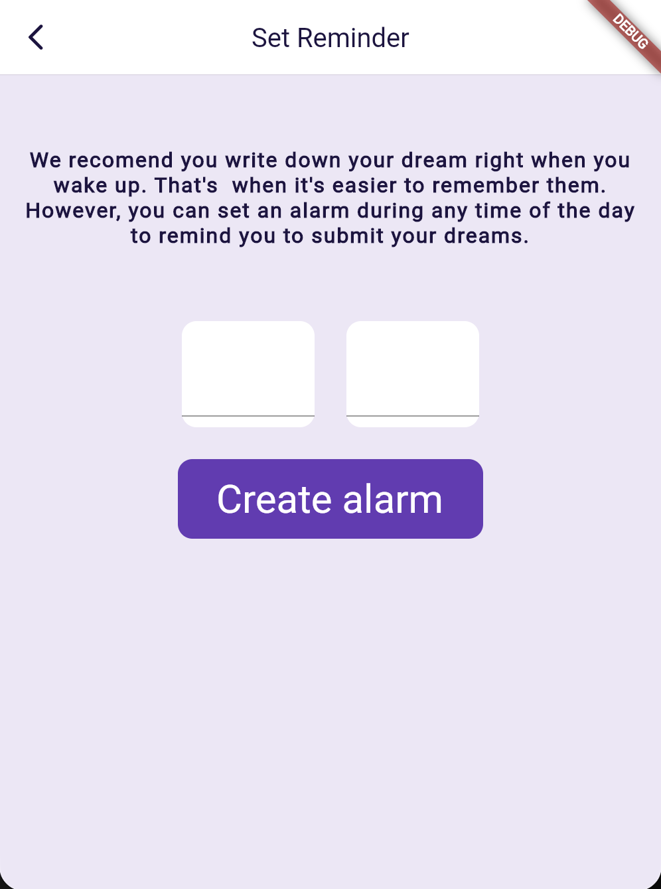
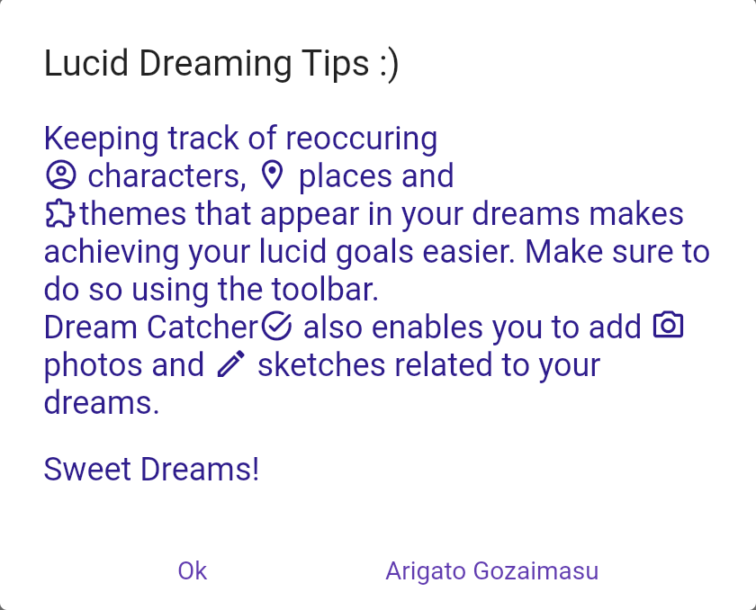
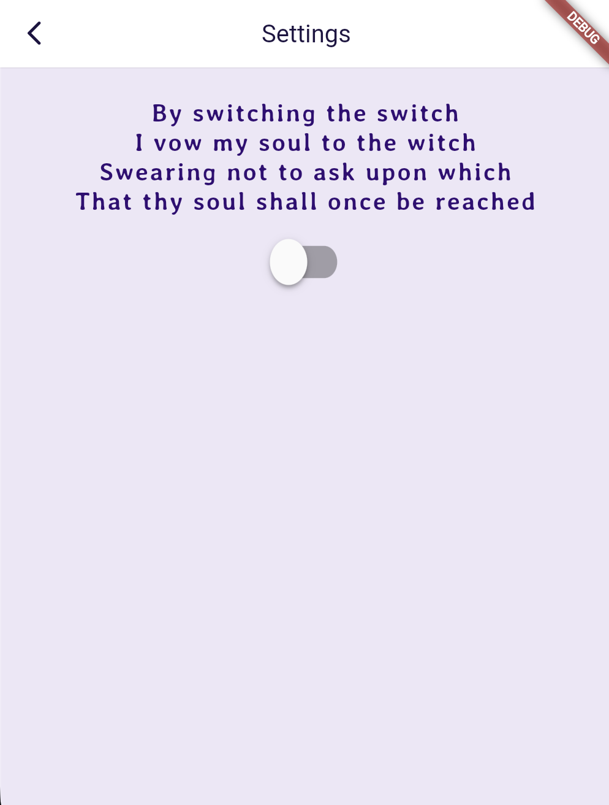
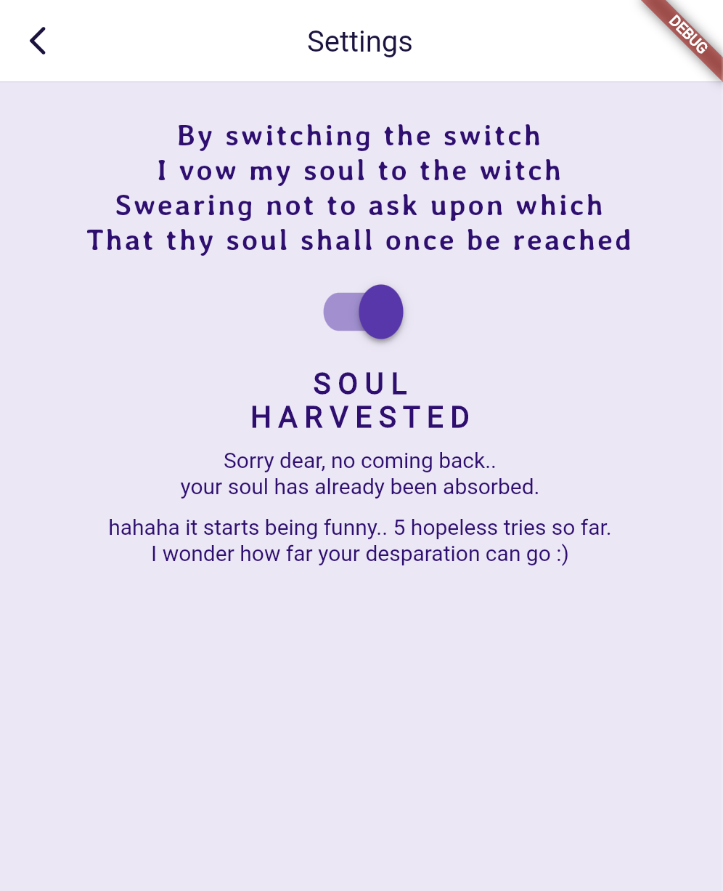
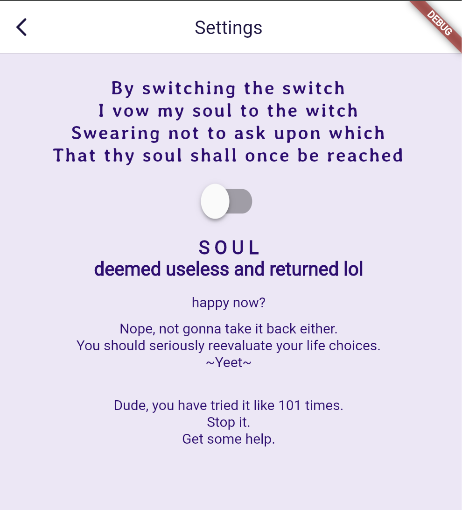

# Dream Catcher – Daily Dream Journal App

A cross-platform mobile and web application designed to record, track, and organize your daily dreams, featuring date logs, image attachments, and symbols tracking.

## Key Features
* **Dream Journaling:** Record and organize your dreams on a daily basis with custom dates and descriptions.
* **Multimedia Support:** Attach images and drawings to capture the vivid visuals of your dreams.
* **Lucid Dreaming Ranks:** Gamification system that assigns ranks based on the number of successful *lucid* dreams achieved.
- **Data & Analytics:** Visual charts to track lucid dreams.
* **Dream Analysis & Links:** Integrated external links and resources to read detailed dream interpretations and analysis.
* **Smart Alarm Clock:** Built-in alarm functionality (`flutter_alarm_clock`).
* **Calendar & Organization:** Interactive calendar and event views to browse past dreams easily.
* **

## Screenshots

| Home & Calendar | Dream Journal Entries| Add Dream | Achievements & Stats |
| :---: | :---: | :---: | :---: |
|  |  |  |  |

| Freehand Sketch Canvas | Smart Alarm Reminder | Tips | Dictionary |
| :---: | :---: | :---: | :---: |
|  |  |  |  |

| Easter Eggs | 
| :---: |
|   |

## Tech Stack & Key Packages
* **Framework:** Flutter `2.10.5` (managed via FVM)
* **Language:** Dart
* **Key Packages & Libraries:**
  * `syncfusion_flutter_charts` – Advanced charting for dream analytics and statistics.
  * `image_picker` – Image selection and attachment for dream logs.
  * `signature` – Digital signature and drawing features.
  * `flutter_alarm_clock` – Alarm and timing management.
  * `intl` – Date formatting and internationalization.
  * `url_launcher` – External link handling.

## Environment & Legacy Note
This repository is preserved in its original 2022 state. To run locally, use Flutter `2.10.5` via [FVM](https://fvm.app/):
